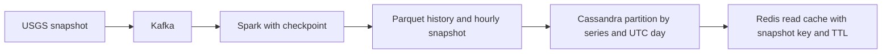
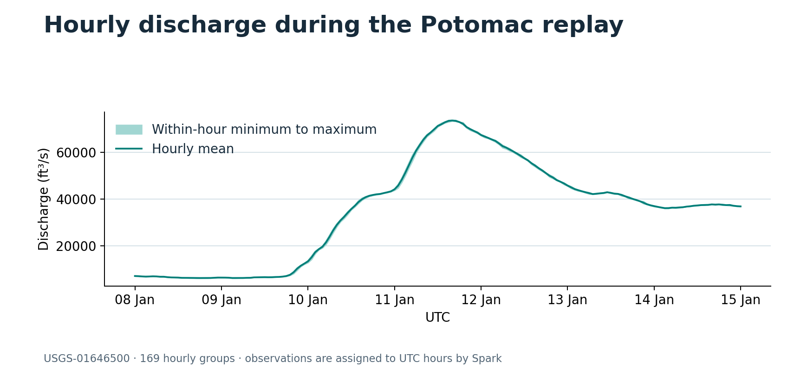
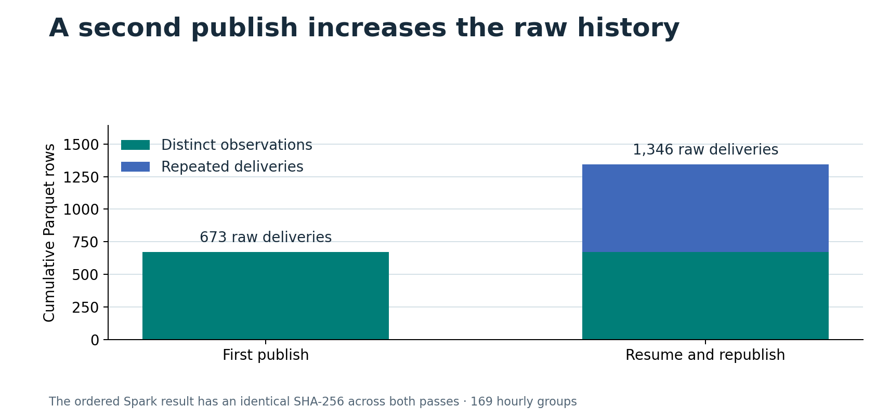
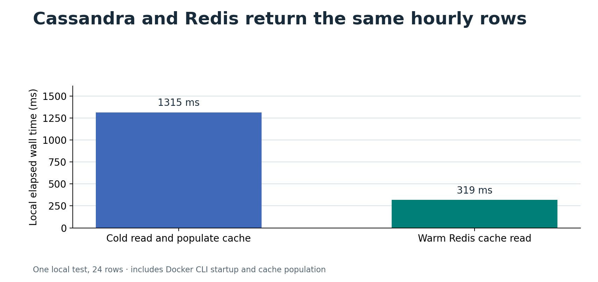

# River Gauge Event-Time Replay

Replay historical USGS streamflow through Apache Kafka and Spark Structured Streaming, then serve the deduplicated hourly results through Cassandra and Redis. The acquisition stage writes checksummed JSON Lines, verifies pagination and interval boundaries, and normalizes time offsets to UTC.

The verified acquisition returned 673 discharge observations in two pages for USGS-01646500 between 8 and 15 January 2024 inclusive. Discharge is reported in ft³/s. The local archive checksum and request parameters are recorded in the [acquisition manifest](reports/potomac-acquisition.json).

```sh
python fetch_observations.py --station USGS-01646500 --start 2024-01-08T00:00:00Z --end 2024-01-15T00:00:00Z --out data/raw/potomac-2024-01
python -m unittest discover -s tests -v
```

The host commands use Python 3.11+ and PowerShell with Docker Compose. The broker uses Apache Kafka 4.1.1 and the Spark job uses Apache Spark 3.5.6 with the matching Scala 2.12 Kafka connector.

## Kafka and Spark replay

Start Docker Desktop, then run the following from the project directory in PowerShell.

```powershell
./demo.ps1
```

The demo creates a fresh topic and output folder for each run. It publishes every row twice and runs a bounded Spark streaming pass after each publish. On the second pass, Spark resumes the original query and reads only the new Kafka offsets. The bronze Parquet history keeps both deliveries. The hourly output retains one record per source revision, selects each observation's newest revision and holds out conflicting newest revisions. Valid observations without a numeric value are counted separately. If a malformed message arrives, the bronze record retains the original payload with an invalid flag.

`runs/<id>/verification.json` includes producer timings, batch IDs, input counts, invalid counts and the digest of the ordered hourly results. The digest must match across both passes. Producer rates include startup, batching and acknowledgments. Each publish verifies the number of appended records against Kafka partition offsets. Historical revision timestamps describe data in the USGS snapshot.

## Verified replay

| Measure | First pass | Restart and second pass |
| --- | ---: | ---: |
| Rows read from Kafka | 673 | 673 |
| Cumulative bronze Parquet rows | 673 | 1,346 |
| Duplicate deliveries excluded from the rollup | 0 | 673 |
| Distinct observations in the rollup | 673 | 673 |
| Hourly groups | 169 | 169 |
| Spark micro-batch time | 3,517 ms | 3,533 ms |

The checkpoint preserved the Spark query ID and advanced the batch ID from 0 to 1. The ordered hourly results had the same SHA-256 across both passes. A separate Spark fixture exercised malformed messages, duplicate deliveries, late older revisions and conflicting newest revisions. [Replay measurements](reports/kafka-spark-verification.json)

## Cassandra and Redis serving



Pass the generated directory name from `runs/` as `-RunId`. The command exports the ordered Spark hourly result and checks its SHA-256 before writes.

```powershell
./serve_demo.ps1 -RunId 'potomac-validation-03'
```

The first and second Cassandra upsert passes each returned all 169 rows across eight partitions. The Redis cache returned the same 24 rows as the selected Cassandra partition. Cache keys include the SHA-256 of the hourly result and entries expire after 900 seconds. [Serving measurements](reports/serving-verification.json)

## Visual Results Gallery



Hourly flow and observed extremes are drawn from the verified Spark export.



The raw history grows on replay. The hourly result keeps one latest valid observation per key.



A single local comparison includes container CLI startup, the Cassandra query and cache population on the cold path.

```sh
python -m pip install -r requirements-visuals.txt
python plot_results.py --run runs/potomac-validation-03
```

## Reproduction limits

The demonstration uses a single station, one week and locally bounded Spark batches. The service configuration uses a single Cassandra replica. Run the separate Spark test to check late revisions, malformed messages and newest-revision conflicts.

```powershell
docker compose run --rm -T spark --master 'local[2]' tests/spark_revision_fixture.py
```

```powershell
docker compose stop kafka
docker compose --profile serving stop cassandra redis
```

The services are bound to the Compose network. Kafka and Cassandra volumes retain data between starts. The Spark checkpoint and analytics outputs stay in the local `runs/` directory. [Spark Kafka connector](https://spark.apache.org/docs/3.5.6/structured-streaming-kafka-integration.html) · [USGS OGC API](https://api.waterdata.usgs.gov/docs/ogcapi) · [USGS data licensing](https://www.usgs.gov/data-management/data-licensing)
